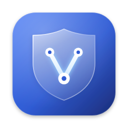
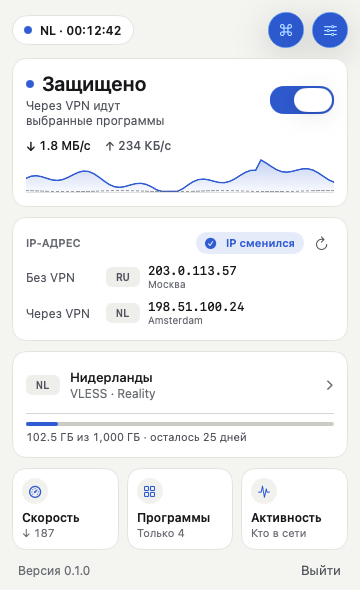
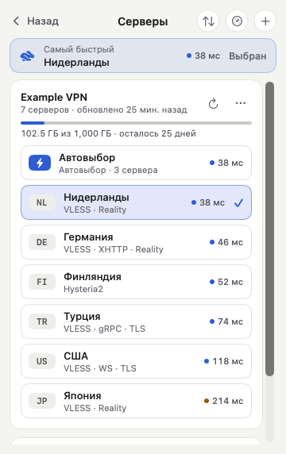
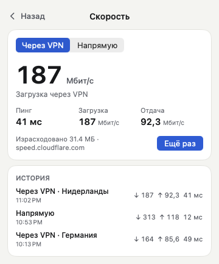
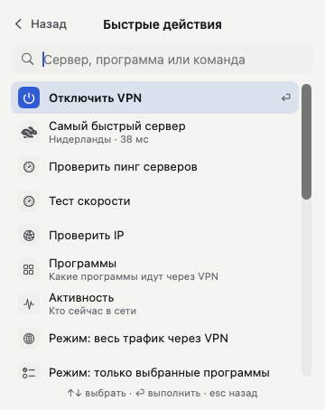
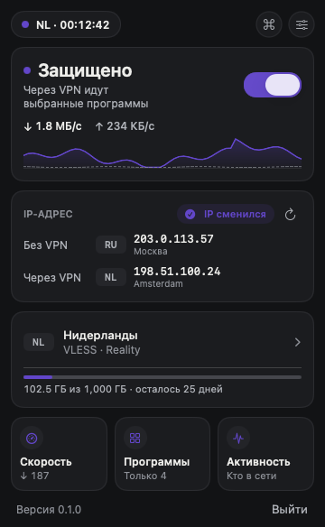
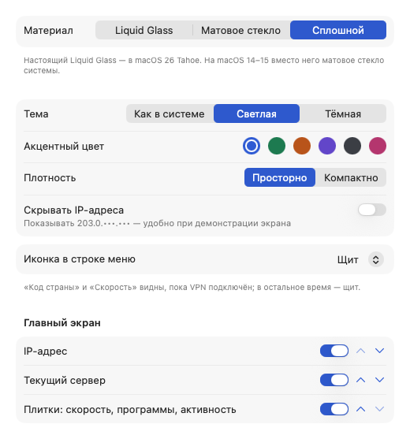
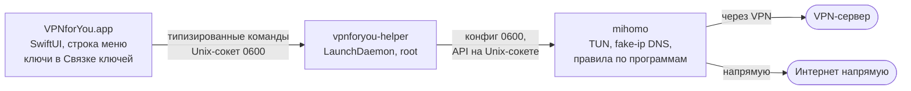

<div align="center">



# VPNforYou

**VPN-клиент для macOS в строке меню, в котором видно, что происходит с подключением,<br>и можно выбрать, какие программы идут через VPN.**

[](https://github.com/aevofounder/vpnforyou/actions/workflows/build-macos.yml)
[](https://github.com/aevofounder/vpnforyou/actions/workflows/secret-scan.yml)


[](LICENSE)

[Скачать бету](https://github.com/aevofounder/vpnforyou/releases/tag/beta) ·
[Установка](docs/INSTALL.md) ·
[План](docs/PLAN.md) ·
[Безопасность](SECURITY.md)



</div>

VPNforYou — клиент: сам VPN в комплект не входит. Ключи или ссылку-подписку даёт ваш продавец VPN, приложение подключается к его серверам через открытое ядро [mihomo](https://github.com/MetaCubeX/mihomo).

## Что умеет

- **Ключи и подписки.** `vless://` (Reality и TLS; TCP, WS, gRPC, XHTTP, HTTPUpgrade), `hysteria2://`, ссылки-подписки (список ключей или Xray JSON). Названия, порядок и «Автовыбор» как у продавца, остаток трафика и дней из подписки.
- **Видно, сменился ли IP.** Карточка «IP без VPN → IP с VPN» со страной и отметкой «IP сменился».
- **Пинг и скорость.** Пинг всех серверов и «Самый быстрый», тест загрузки и отдачи через VPN и напрямую, живой график в карточке статуса.
- **Программы ползунками.** Весь трафик, только выбранные программы или все, кроме выбранных. Ползунки срабатывают сразу, без переподключения. Окно «Активность» показывает, кто сейчас в сети и каким путём.
- **Под рукой.** Быстрые действия по ⌘K, ⌥⌘V из любой программы, автозапуск и подключение к последнему серверу.
- **Внешний вид.** Liquid Glass на macOS 26 (на 14–15 матовое стекло), тема, шесть акцентов, вид иконки в строке меню, плотность, порядок карточек, скрытие IP при демонстрации экрана.
- **Обновляется само.** Бета-версии приходят через Sparkle, каждое обновление подписано ключом проекта.
- **Приватно.** Ключи хранятся только на вашем маке, в Связке ключей. Телеметрии нет.

## Как выглядит

<table>
  <tr>
    <td align="center" width="33%"><br><sub>Серверы и «Самый быстрый»</sub></td>
    <td align="center" width="33%"><br><sub>Программы ползунками</sub></td>
    <td align="center" width="33%"><br><sub>Тест скорости</sub></td>
  </tr>
  <tr>
    <td align="center"><br><sub>Быстрые действия ⌘K</sub></td>
    <td align="center"><br><sub>Тёмная тема, свой акцент</sub></td>
    <td align="center"><br><sub>Первый запуск</sub></td>
  </tr>
  <tr>
    <td align="center" colspan="2"><br><sub>Активность: кто в сети и каким путём</sub></td>
    <td align="center"><br><sub>Настройки</sub></td>
  </tr>
</table>

Снимки рисует CI на macOS 26 из настоящего кода интерфейса, на ненастоящих данных ([`screenshots.yml`](.github/workflows/screenshots.yml)).

## Установка

Нужен Mac с macOS 14 Sonoma или новее, Apple Silicon или Intel.

1. Скачайте `VPNforYou-….zip` из релиза [`beta`](https://github.com/aevofounder/vpnforyou/releases/tag/beta), распакуйте и перенесите `VPNforYou.app` в «Программы».
2. Сборка не подписана сертификатом Apple, поэтому первый запуск macOS заблокирует: **Системные настройки → Конфиденциальность и безопасность → «Всё равно открыть»**.
3. Щит в строке меню → **Добавить ключ или подписку** → вставьте ссылку от продавца VPN.
4. **Установить помощника** (пароль администратора один раз) → включите VPN.

Пошагово, с картинками, обновлением и удалением: [docs/INSTALL.md](docs/INSTALL.md).

## Как устроено



- **Приложение** хранит ключи, показывает интерфейс и отправляет помощнику только типизированные команды: какие серверы, какой режим, какие программы.
- **Помощник** работает от имени root, потому что TUN и маршруты требуют прав администратора. Он сам строит конфиг ядра, принимает команды только от вашей учётной записи и выполняет короткий список разрешённых вызовов API.
- **mihomo** забирает весь трафик через TUN, для каждого соединения узнаёт процесс и по файлу правил решает, идти через VPN или напрямую. Файл правил ядро перечитывает на лету, поэтому ползунки работают без переподключения.

Почему mihomo, а не sing-box, как устроен выбор программ и какие у него ограничения: [docs/PLAN.md](docs/PLAN.md).

## Безопасность и приватность

- Ключи и подписки хранятся только в Связке ключей macOS. Конфиг ядра с ключами живёт, пока VPN включён: в папке root, с правами `0600`.
- У API ядра нет TCP-порта, только Unix-сокет в папке root. Другие программы не могут через него поменять конфиг ядра.
- Внешние запросы только по вашему действию или настройке: обновление подписки, проверка IP, тест скорости, проверка обновлений.
- Обновление встанет, только если оно подписано закрытым ключом проекта (Ed25519, [docs/UPDATES.md](docs/UPDATES.md)).
- «Скопировать логи без секретов» заменяет ключи, UUID, IP-адреса и адреса серверов на заглушки.
- В репозитории нет настоящих ключей: каждый push проверяет gitleaks с правилами для ссылок VPN, UUID и паролей в конфигах.

Нашли уязвимость? Не пишите в открытый issue, отправьте [приватный отчёт](https://github.com/aevofounder/vpnforyou/security/advisories/new). Подробнее в [SECURITY.md](SECURITY.md).

## Разработка

Интерфейс собирается только на macOS с Xcode 26. Логика в пакете `VPNCore` использует только Foundation, поэтому тесты идут и на Linux.

```sh
swift test --package-path Packages/VPNCore     # тесты логики и помощника
brew install xcodegen && xcodegen generate     # VPNforYou.xcodeproj из project.yml
open VPNforYou.xcodeproj
scripts/bundle-extras.sh path/to/VPNforYou.app # положить в .app помощника и ядро mihomo
```

| Папка | Что внутри |
|---|---|
| [`App/`](App) | приложение на SwiftUI: экраны, Связка ключей, установка помощника, обновления |
| [`Packages/VPNCore/`](Packages/VPNCore) | разбор ключей и подписок, конфиг mihomo, правила для программ, маскировка логов; помощник `vpnforyou-helper` |
| [`scripts/`](scripts) | упаковка помощника и ядра, `.dmg`, `appcast.xml` |
| [`design/icon/`](design/icon) | исходники иконки в SVG |
| [`docs/`](docs) | план, дизайн, установка, обновления, скриншоты |

| Workflow | Когда | Что делает |
|---|---|---|
| [Build macOS](.github/workflows/build-macos.yml) | каждый push и PR | тесты, универсальная сборка, ядро mihomo с проверкой SHA-256, `mihomo -t`, `.zip`; из `main` публикует бету |
| [Secret scan](.github/workflows/secret-scan.yml) | каждый push и PR | gitleaks по всей истории |
| [Release](.github/workflows/release.yml) | тег `v*` | `.dmg` с SHA-256 и черновик релиза; публикует владелец |
| [Screenshots](.github/workflows/screenshots.yml) | `[screenshots]` в коммите | рисует экраны на ненастоящих данных |

Как предложить изменение и какие данные можно класть в тесты: [CONTRIBUTING.md](CONTRIBUTING.md).

## Статус и планы

Этапы 0–7 из [плана](docs/PLAN.md) сделаны, бета-канал обновляется после каждого изменения в `main`. Идёт проверка на маке с настоящей подпиской.

Дальше:

- первый стабильный релиз `v0.1.0`;
- kill switch: если VPN упал, выбранные программы не выходят в сеть напрямую;
- подписки в формате Clash YAML, протоколы trojan, vmess, shadowsocks, tuic;
- подпись и нотаризация, если появится аккаунт Apple Developer.

## Благодарности

- [mihomo](https://github.com/MetaCubeX/mihomo) (GPL-3.0): ядро, через которое идёт весь трафик.
- [Sparkle](https://sparkle-project.org) (MIT): автообновления.
- [XcodeGen](https://github.com/yonaskolb/XcodeGen) (MIT): проект Xcode из `project.yml`.
- [gitleaks](https://github.com/gitleaks/gitleaks) (MIT): проверка секретов в CI.

## Лицензия

[GPL-3.0](LICENSE). В приложение входит mihomo под той же лицензией.
