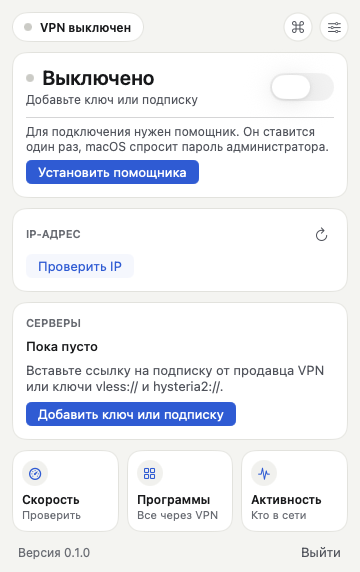
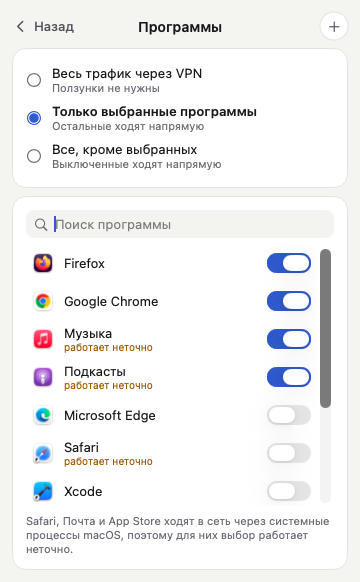
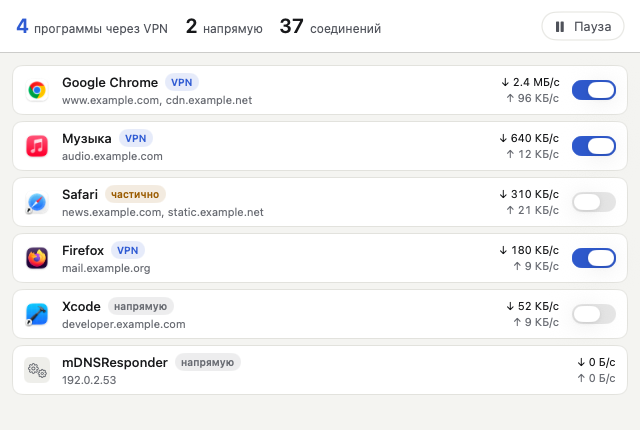

# Установка и первый запуск

VPNforYou работает на macOS 14 Sonoma и новее, на Apple Silicon и Intel.
Сборка не подписана сертификатом Apple Developer, поэтому при первом запуске macOS попросит подтверждение.

## 1. Скачать

- **Бета (сейчас основной способ):** релиз [`beta`](https://github.com/aevofounder/vpnforyou/releases/tag/beta), файл `VPNforYou-….zip`. Его достаточно поставить один раз: следующие версии приложение поставит само.
- **Стабильный релиз:** страница [Releases](https://github.com/aevofounder/vpnforyou/releases), файл `VPNforYou-x.y.z.dmg`, когда он выйдет.
- **Сборка из pull request:** вкладка Actions → запуск «Build macOS» → артефакт `VPNforYou.zip`. Сама такая сборка не обновляется.

Для `.dmg` сверьте контрольную сумму с той, что указана в релизе:

```sh
shasum -a 256 ~/Downloads/VPNforYou-x.y.z.dmg
```

Если суммы не совпадают, не открывайте файл.

## 2. Поставить

1. Откройте `.dmg` и перетащите **VPNforYou** в папку **Программы**. Если скачали `.zip`, распакуйте его и перенесите `VPNforYou.app` туда же.
2. Если у вас открыт другой VPN-клиент (например, Incy), отключите в нём VPN: два VPN с режимом TUN одновременно мешают друг другу.

## 3. Первый запуск

1. Откройте VPNforYou из папки «Программы». macOS покажет окно «Не удалось проверить "VPNforYou"». Нажмите **Готово**.
2. Откройте **Системные настройки → Конфиденциальность и безопасность**, прокрутите вниз до строки «Программа "VPNforYou" заблокирована» и нажмите **Всё равно открыть**. Введите пароль.
3. Запустите VPNforYou ещё раз и нажмите **Открыть**.

В строке меню появится щит. Иконки в Dock у приложения нет: всё управление идёт из строки меню.

## 4. Добавить ключи

1. Нажмите на щит → **Добавить ключ или подписку**.
2. Вставьте ссылку на подписку от продавца VPN (`https://…`) или ключи `vless://…`, `hysteria2://…`, по одному в строке. Кнопка **Вставить из буфера** вставляет то, что вы скопировали.
3. Нажмите **Добавить**. Появится список регионов.

Ключи хранятся в Связке ключей macOS. При первом обращении macOS спросит: «VPNforYou хочет использовать конфиденциальную информацию…». Нажмите **Разрешить всегда**. После обновления приложения вопрос может появиться снова: сборка без подписи Apple для macOS каждый раз выглядит новой программой.

## 5. Установить помощника и подключиться



Для VPN нужны права администратора: ядро создаёт виртуальный сетевой интерфейс и меняет маршруты.

1. Нажмите **Установить помощника** на главном экране и введите пароль администратора. Это нужно один раз.
2. Включите переключатель VPN. Через пару секунд статус станет «Защищено», а в карточке IP появится «IP сменился».

Что ставит помощник:

| Путь | Что это |
|---|---|
| `/Library/PrivilegedHelperTools/io.github.aevofounder.vpnforyou.helper` | сам помощник |
| `/Library/LaunchDaemons/io.github.aevofounder.vpnforyou.helper.plist` | автозапуск помощника |
| `/Library/Application Support/VPNforYou/` | ядро mihomo и временный конфиг (только для root) |
| `/Library/Logs/VPNforYou-helper.log` | журнал помощника |

Помощник слушает сокет, который может открыть только ваша учётная запись. Конфиг с ключами живёт только пока VPN включён и удаляется при отключении.

## 6. Выбрать программы



Главный экран → плитка **Программы**:

- **Весь трафик через VPN** — как в обычном VPN.
- **Только выбранные программы** — через VPN идут только включённые ползунком.
- **Все, кроме выбранных** — выключенные ползунком идут напрямую.

Ползунки срабатывают сразу, без переподключения. Программу, которой нет в списке, можно добавить кнопкой «+».
Safari, Почта и App Store ходят в сеть через системные процессы macOS, поэтому для них выбор работает неточно.

Окно **Активность** показывает, какие программы сейчас в сети и идут ли они через VPN.



## 7. Полезное

- **⌥⌘V** в любой программе включает и выключает VPN (отключается в настройках).
- **⌘K** в окне VPNforYou открывает быстрые действия: поиск сервера, программы или команды.
- **Скорость:** плитка на главном экране, тест через VPN и напрямую (до 35 МБ трафика).
- **Пинг:** экран «Серверы» → кнопка со спидометром, затем сортировка «По пингу».
- **Настройки** (кнопка с ползунками): автозапуск, подключение при запуске, вид иконки, тема, цвет, порядок карточек, «Скрывать IP-адреса».

## Обновление

Приложение обновляется само из бета-канала: раз в 6 часов проверяет новую версию и предлагает **Установить** (вручную: **Настройки → Основные → Проверить обновления** или ⌘K). Если VPN был включён, после перезапуска он включится снова. Как это устроено и как настроить ключ обновлений: [UPDATES.md](UPDATES.md).

Сборки, скачанные из Actions, сами не обновляются: поставьте один раз сборку из релиза [`beta`](https://github.com/aevofounder/vpnforyou/releases/tag/beta). Если формат команд помощника изменился, приложение предложит **Обновить помощника** (снова пароль администратора).

## Удаление

1. **Настройки → Подключение → Удалить помощника** (macOS спросит пароль). Это убирает всё из таблицы выше.
2. Перетащите VPNforYou из «Программ» в Корзину.
3. Ключи: откройте «Связка ключей», найдите `io.github.aevofounder.vpnforyou` и удалите записи.

Если приложения уже нет, помощника можно убрать в Терминале:

```sh
sudo launchctl bootout system/io.github.aevofounder.vpnforyou.helper
sudo rm -f /Library/LaunchDaemons/io.github.aevofounder.vpnforyou.helper.plist \
  /Library/PrivilegedHelperTools/io.github.aevofounder.vpnforyou.helper \
  /var/run/io.github.aevofounder.vpnforyou.helper.sock \
  /Library/Logs/VPNforYou-helper.log
sudo rm -rf "/Library/Application Support/VPNforYou"
```

## Если что-то не работает

**Настройки → Основные → Скопировать логи без секретов** кладёт в буфер обмена отчёт: версии, состояние и последние строки журналов. Ключи, UUID, IP-адреса и адреса серверов в нём заменены на `[скрыто]`, `[uuid]`, `[ip]` и `[сервер]`. Просмотрите отчёт перед отправкой. Не присылайте настоящие ключи ни в issues, ни в чат.
